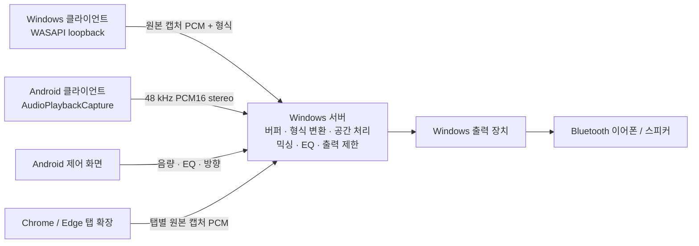

# Sound Manager

여러 Windows·Android 기기의 재생음을 Windows 서버에서 합쳐 Bluetooth 이어폰·스피커로 출력하는 초기 MVP입니다. Android 앱에서 QR로 연결하고 전체 음량, EQ와 음원별 방향을 조정합니다. 외부 네트워크에서는 앱의 Cloudflare HTTPS 터널을 사용할 수 있습니다.

[v0.4.0 릴리스 및 다운로드](https://github.com/lunce0503/sound_manger/releases/tag/v0.4.0) · [변경 사항](docs/releases/v0.4.0.md)



## 구현 범위

- **Windows**: 서버/클라이언트 중 한 역할 선택. WASAPI 캡처/출력, 연결 QR·연결 코드, 선택적 외부 HTTPS 터널, 음량 및 EQ 프리셋. 창을 닫으면 트레이에서 서버·출력·전송을 유지합니다. 기기별 음량·음소거·방향·공간 효과 설정을 저장해 재연결 시 복원합니다.
- **Android 10 이상**: QR로 한 번 인증한 뒤 자동 재연결. 전체 음량과 기기 목록이 있는 기본 화면, 별도 EQ·방향 설정 창, 스피커 아이콘·음소거 글자·스위치. 주소/키는 연결 관리 안에서만 입력합니다. 재생 오디오 전송과 알림에서 전송 중지를 지원합니다.
- **서버 코어**: 최대 16개 음원, PCM16/float32 LE, 모노/스테레오, 8–192 kHz 입력. 서버에서 48 kHz float stereo로 변환하고 혼합. 입력별 제한된 버퍼, 언더런 재버퍼링, 소규모 클럭 드리프트 보정, 최종 출력 ±1 제한과 클리핑 계수.
- **Chrome·Edge 데스크톱 116 이상**: 탭마다 독립된 음원으로 전송합니다. 확장 팝업을 닫아도 계속 전송하며 서버 연결이 끊기면 재연결합니다. 브라우저 재시작 후에는 탭에서 전송을 다시 시작합니다.
- **EQ**: 120 Hz 저음 shelf, 4 kHz 고음 shelf, 2.5 kHz presence peaking, 각 ±12 dB. 기본/저음 강조/고음 강조/부드럽게/선명하게 프리셋.
- **가상 방향**: 좌우 레벨 차, 최대 약 0.63 ms 귀간 지연, 후방 고주파 감쇠. HRTF·머리 추적·실제 다채널 360° 렌더러는 아직 구현하지 않았습니다. 스피커와 청취 환경에 따라 전후 구별이 제한됩니다. 방향 사용 시 해당 스테레오 입력을 모노로 합쳐 배치하며, 꺼두면 좌우 채널을 유지합니다.

## 실행

1. Windows 서버 PC에 Bluetooth 이어폰/스피커를 페어링합니다.
2. 배포한 `SoundManager-0.4.0-windows-x64.exe`를 실행합니다. 필요한 파일이 사용자 앱 폴더에 자동으로 풀리고 앱이 열립니다. 출력 장치를 선택한 뒤 **서버 시작**을 누릅니다.
3. Windows 방화벽 알림에서는 사용하는 **개인 네트워크** 접근을 허용합니다. 수동 설정이 필요한 경우 서버 TCP `17842`를 같은 LAN에 허용합니다.
4. Windows의 **새 기기 연결 · QR 인증**을 펼쳐 휴대폰과 같은 네트워크의 주소를 선택합니다. Android의 **연결 관리 → QR로 서버 연결**에서 스캔하고 주소를 확인하여 연결합니다. 카메라 없이 연결 코드를 붙여넣거나 연결 관리의 **주소와 키로 연결**을 사용할 수도 있습니다.
5. Android에서 **재생음 전송 시작**을 누르고 오디오 권한 및 시스템 캡처 승인을 합니다. 캡처 가능한 앱에서 음악을 재생합니다. 서버의 출력 장치로 합산된 음원이 재생됩니다.
6. 다른 Windows PC는 **복사한 연결 코드 적용**으로 주소/키를 입력한 뒤 **음원 전송 시작**을 누릅니다. Android에서 전체 EQ와 각 음원의 가상 방향을 조정합니다.

인증이 성공하면 Android는 주소와 키를 Android Keystore AES-GCM으로 암호화해 저장합니다. 앱을 닫았다 열면 저장된 인증으로 연결하며, 일시적인 연결 실패 시에도 인증을 지우지 않고 재시도합니다. **연결 관리 → 저장된 연결 지우기**로 해제합니다. Windows 서버 키도 사용자별 DPAPI로 보관해 재시작 시 재사용합니다. Windows 클라이언트 연결도 암호화해 보관합니다. OS의 재생 오디오 캡처 승인은 서버 인증과 별개로 필요합니다.

### 기기별 음량·음원 위치 유지

Windows 서버와 음원을 보내는 Windows/Android 앱을 모두 v0.4.0 이상으로 업데이트하세요. 기기별 음량·음소거·방향 각도·공간 효과 사용 여부를 바꾸면 서버가 즉시 저장합니다. 연결 종료, 캡처 재시작, 네트워크 단절 후 재연결 및 서버 앱 재시작에도 마지막으로 저장한 설정을 복원합니다. 연결이 끊긴 음원은 활성 기기 목록에서 사라지지만 저장된 설정은 유지됩니다.

각 전송 앱은 무작위 기기 ID를 보관해 모델명이나 PC 이름이 같아도 구분합니다. 이름을 바꿔도 ID가 같으면 같은 설정을 적용하며, 새 연결의 첫 PCM을 처리하기 전에 복원합니다. 이전 연결이 아직 시간 초과되지 않았어도 재연결이 기존 연결을 교체합니다. 전체 음량·EQ는 기기 연결/해제로 변경하지 않습니다.

서버 설정 파일은 `%LOCALAPPDATA%/SoundManager/source-settings.json`, Windows 전송 기기 ID는 `%LOCALAPPDATA%/SoundManager/client-device-id.txt`에 보관합니다. Android는 앱 전용 저장소에 ID를 유지합니다. 앱 업데이트와 인증 정보 변경은 ID를 지우지 않습니다. 앱 데이터/ID 파일 삭제 또는 앱 재설치로 ID가 사라지면 새 기기로 처리합니다. ID는 인증 키나 하드웨어 식별자가 아닙니다.

ID를 보내지 않는 이전 전송 앱도 연결되지만 기기별 자동 복원을 지원하지 않습니다. 저장 실패는 오류로 알리고 이전 설정을 유지하며, 손상된 저장 파일을 자동으로 덮어쓰지 않습니다. v0.3.2까지의 앱은 기기별 설정을 저장하지 않았으므로 업데이트 후 지정한 설정부터 유지됩니다.

### 기기 목록과 서버에서 조절

Windows 서버와 Android 앱의 목록 행은 **이름 · 스피커 아이콘과 음소거 토글 · ⋮**로 구성합니다. **⋮ → 음량 조절 / 이름 변경 / 360° 방향 설정**에서 조절합니다. 음량은 0–200%, 이름은 1–64자입니다. **원래 이름으로**로 사용자 지정 이름을 해제합니다. Windows 서버에서 직접 바꾼 설정도 저장하고 휴대폰에 반영합니다. 변경한 항목만 업데이트해 다른 컨트롤의 설정을 덮어쓰지 않습니다.

### Chrome·Edge 탭별 전송

1. 최신 Windows EXE에서 **브라우저 탭 연결 → 브라우저 확장 설치 폴더 열기**를 누릅니다.
2. Chrome의 `chrome://extensions` 또는 Edge의 `edge://extensions`에서 개발자 모드를 켜고 **압축해제된 확장 프로그램 로드**로 열린 폴더를 선택합니다. 로컬 확장으로 배포합니다. [Chrome 설치 안내](https://developer.chrome.com/docs/extensions/get-started/tutorial/hello-world#load-unpacked)
3. 서버의 **새 기기 연결 · QR 인증 → 연결 코드 복사**로 복사한 코드를 전송할 탭의 Sound Manager 확장 → **서버 연결 관리**에 붙여넣습니다. 해당 서버 호스트의 접근 권한을 허용하면 인증을 저장합니다.
4. **새 탭 음원 → 이 탭 전송 시작**을 누릅니다. 다른 탭에서도 반복하면 각각 서버·휴대폰 목록에 나타납니다. 각 행의 음소거와 ⋮ 메뉴로 조절합니다. 팝업을 닫아도 전송합니다.
5. 탭이나 브라우저를 다시 열었을 때는 **저장된 탭 설정**에서 기존 항목을 골라 전송하면 이전 설정을 복원합니다. 같은 항목은 동시에 두 탭에서 사용하지 않습니다.

캡처는 사용자가 확장을 실행한 탭에서 시작해야 합니다. [공식 탭 캡처 API](https://developer.chrome.com/docs/extensions/reference/api/tabCapture) 전송 중인 탭의 소리는 서버 출력으로 전달되며 원래 탭의 로컬 재생은 억제됩니다. 탭 전송을 사용할 때 해당 PC의 전체 재생음 전송은 중지해 중복 전송과 출력 재입력을 피하세요. 캡처 금지·DRM 음원이나 브라우저 내부 페이지는 지원하지 않을 수 있습니다. Android 모바일 브라우저의 탭 캡처는 지원 범위에 포함하지 않습니다.

확장은 주소와 키를 AES-GCM으로 암호화해 확장 전용 저장소에 저장합니다. 암호화 키는 브라우저 프로필의 IndexedDB에 비추출 CryptoKey로 보관하며 OS 하드웨어 키 저장소의 보호를 보장하지 않습니다. 키를 URL·기본 화면·동기화 저장소에 넣지 않습니다. 브라우저 프로필/확장 데이터를 지우면 연결과 탭 ID가 사라집니다.

확장 폴더는 `%LOCALAPPDATA%/SoundManager/browser-extension`으로 유지합니다. 앱 업데이트 후 설치 폴더 열기를 다시 누르고 확장 관리에서 새로고침하세요. 같은 공개 확장 ID를 사용하므로 확장을 삭제하지 않고 새로고침하면 저장된 연결과 탭 설정을 유지합니다.

### Windows 백그라운드 실행

창의 **X** 또는 **Alt+F4**를 누르면 작업 표시줄의 숨겨진 아이콘(시스템 트레이)으로 들어갑니다. 서버, Bluetooth 출력, Windows 음원 전송, 켜둔 외부 터널은 계속 실행됩니다. 창만 닫은 경우 외부 주소도 유지됩니다.

트레이 아이콘을 두 번 클릭하거나 메뉴의 **Sound Manager 열기**로 창을 복원합니다. EXE를 다시 실행해도 같은 Windows 로그인 세션의 기존 창을 엽니다. 종료하려면 트레이 메뉴 또는 창 하단의 **완전 종료 (서버 중지)**를 누릅니다. 전송과 서버, 외부 터널을 정리한 뒤 앱이 종료됩니다.

Windows에 로그인한 상태에서 앱이 실행되어 있어야 합니다. PC 절전 중에는 작동하지 않습니다. 이전 버전 앱은 먼저 완전 종료한 후 새 EXE를 실행하세요.

### Windows 로그인 시 서버 자동 시작

1. 자동 시작에 사용할 Bluetooth 이어폰/스피커를 연결하고 **출력 장치**에서 선택합니다.
2. **시작 설정 → Windows 로그인 시 백그라운드 실행 및 서버 자동 시작**을 켭니다. 기본값은 꺼짐입니다.
3. 다음 Windows 로그인부터 창을 표시하지 않고 트레이에서 서버를 시작합니다. 저장한 출력 장치나 오디오 서비스가 아직 준비되지 않았으면 5초 간격으로 재시도합니다. 선택한 장치가 없을 때 다른 스피커로 바꾸지 않습니다.
4. 트레이 아이콘으로 앱을 열면 서버 상태와 저장된 출력 장치를 확인할 수 있습니다. 자동 시작을 기다리는 중에도 서버/전송 버튼으로 수동 조작하거나 완전 종료할 수 있습니다.
5. 같은 옵션을 끄면 다음 로그인부터 자동 실행을 해제하고 대기 중인 자동 시작을 취소합니다. 현재 실행 중인 서버는 유지합니다. **완전 종료**는 이번 실행만 종료하며 다음 로그인 설정은 보존합니다.

현재 Windows 사용자에게만 적용되고 관리자 권한이 필요하지 않습니다. [Windows 로그인 시작 프로그램](https://learn.microsoft.com/windows/win32/setupapi/run-and-runonce-registry-keys)에 등록하므로 로그인 전에는 실행되지 않습니다. Windows 설정/작업 관리자의 시작 앱에서 사용 안 함으로 바꾸면 해당 앱을 다시 허용해야 합니다.

배포 EXE가 풀어둔 사용자 앱 폴더에서 시작하므로 다운로드한 원본 EXE를 옮겨도 동작합니다. 새 버전을 처음 열 때 켜둔 자동 실행 등록도 새 버전으로 갱신합니다. 사용자 앱 폴더를 삭제하면 다시 EXE를 실행하고 설정을 확인하세요. 서버 인증 키는 기존 DPAPI 저장소에서 재사용합니다. 외부 연결은 서버 시작 후 **외부 네트워크 연결 켜기**에서 설정하며 새 임시 주소 QR이 필요할 수 있습니다.

### 다른 Wi-Fi / 모바일 데이터로 연결

1. Windows 서버를 시작한 뒤 **외부 네트워크 연결 켜기**를 누릅니다.
2. 앱이 HTTPS 주소의 실제 접속을 확인하고 QR을 갱신할 때까지 기다립니다.
3. 휴대폰의 연결 관리에서 새 QR을 스캔합니다. 같은 LAN에 있지 않아도 제어와 PCM 전송이 가능합니다. 별도 도메인·Cloudflare 계정·공유기 포트포워딩은 필요하지 않습니다.
4. 휴대폰 앱만 닫았다 열면 같은 주소로 자동 재연결합니다. **외부 네트워크 연결 끄기** 또는 Windows 서버 중지/종료 후 터널을 다시 열면 임시 주소가 바뀌므로 새 주소 QR이 필요합니다. LAN 주소가 바뀌었을 때도 새 주소를 연결해야 합니다.

배포 EXE에는 `cloudflared.exe`가 포함되어 자동으로 함께 풀립니다. 앱은 고정한 버전과 SHA256을 확인한 뒤 숨겨진 자식 프로세스로 실행하며 종료 시 정리합니다. 소스에서 `dotnet run`으로 실행할 때는 `scripts/prepare-tunnel.ps1 -OutputDirectory <실행 폴더>`로 도구를 준비해야 합니다.

외부 모드는 Cloudflare **Quick Tunnel**을 사용한 시험용 연결입니다. 임시 주소이며 서비스 가용성을 보장하지 않습니다. 오디오는 Cloudflare를 경유하고 Cloudflare가 HTTPS를 종료하므로 기기 간 종단간 암호화는 아닙니다. QR/연결 코드를 가진 사람은 서버를 제어할 수 있으므로 연결할 기기에만 공유합니다. [공식 Quick Tunnel 안내](https://developers.cloudflare.com/tunnel/get-started/quick-tunnels/)

## 개발 및 빌드

Windows 빌드에는 .NET 10 SDK와 Node.js 24, Android 빌드에는 JDK 17 또는 21, Android SDK 35 / Build Tools 35.0.0이 필요합니다. Android Studio에서 `android` 폴더를 열어도 됩니다. Gradle Wrapper 8.11.1과 Android Gradle Plugin 8.9.2를 고정했습니다.

```powershell
dotnet build SoundManager.sln -c Release
dotnet test tests/SoundManager.Tests -c Release
dotnet test tests/SoundManager.Windows.Tests -c Release
node --test browser-extension/tests/*.test.js
dotnet run --project src/SoundManager.Windows

# Android: ANDROID_HOME 설정 또는 android/local.properties에 sdk.dir 지정
cd android
.\gradlew.bat assembleDebug lintDebug testDebugUnitTest
```

전체 빌드 및 배포 폴더 생성:

```powershell
.\scripts\build.ps1
# Windows만 빌드하려면 .\scripts\build.ps1 -SkipAndroid
```

- Windows 개발용 실행 폴더: `artifacts/windows/SoundManager.Windows.exe` (x64, .NET 런타임 포함). 사용자 배포에는 아래의 단일 EXE를 사용합니다.
- Android 개발용: `artifacts/android/SoundManager-debug.apk`.
- 릴리스: `scripts/release.ps1`로 **단일 Windows EXE**와 **릴리스 서명 APK**, `SHA256SUMS.txt`를 `artifacts/release/v0.4.0`에 생성합니다. Windows 배포는 앞으로 항상 EXE이며 ZIP은 내부 패키징에만 사용합니다. EXE는 구성 파일 무결성을 확인하고 `%LOCALAPPDATA%/SoundManager/versions`에 풀어 실행합니다. Android 서명 키는 `%LOCALAPPDATA%/SoundManager/release-signing`에 보관하며 업데이트를 위해 보존해야 합니다. [릴리스·서명 안내](docs/releasing.md)
- CI: push/PR마다 Windows 빌드·테스트, Android APK 빌드·lint를 실행하고 GitHub Actions artifact로 저장합니다.

### 실제 브라우저 캡처 검증

실제 브라우저 캡처 회귀 검증은 다음처럼 실행합니다. 격리된 프로필과 로컬 합성 음원만 사용하며 사용자 탭·실제 오디오 출력 장치를 사용하지 않습니다.

```powershell
dotnet build tools/SoundManager.BrowserCheck -c Release
cd browser-extension
npm ci
npx playwright install chromium
npm run e2e
```

빌드가 완료된 뒤 테스트를 실행하세요. 실행 중인 테스트 서버의 파일을 다시 빌드하지 않습니다. CI도 빌드·브라우저 검증을 순서대로 수행합니다.

## 현재 제약

- Android는 재생 앱의 캡처 허용 정책을 따릅니다. DRM, 통화, 캡처 금지 앱의 소리는 전송되지 않을 수 있습니다. 마이크를 대신 녹음하지 않습니다. [Android 공식 문서](https://developer.android.com/media/platform/av-capture)
- 클라이언트는 캡처 이후 EQ/음량/리샘플링을 하지 않습니다. OS가 제공한 캡처 PCM을 전송하므로 **원본 음원 파일과 비트 단위 동일함을 보장하지는 않습니다**. Android 캡처 형식은 API에 48 kHz/16-bit/stereo를 요청합니다. Windows는 기본 출력 장치의 캡처 형식을 사용하며, 현재 16-bit PCM 또는 32-bit float의 모노/스테레오만 지원합니다.
- 초기 구성에서 서버는 Windows입니다. Android 서버와 Android Bluetooth 출력 호스트는 후속 범위입니다. 서버와 Windows loopback 클라이언트를 같은 PC에서 함께 실행하면 피드백이 발생할 수 있으므로 서로 다른 PC를 사용합니다. 클라이언트의 로컬 재생음은 자동으로 음소거하지 않습니다.
- 버퍼 시작 기준은 40 ms, 목표 약 60 ms, 최대 약 500 ms이며 Bluetooth/OS/네트워크 지연이 추가됩니다. 장치 간 절대 시간 동기화·동일 음원에 대한 샘플 단위 정렬은 아직 없습니다. 입력 레이트 변환은 선형 보간이며 스튜디오 품질 변환기는 아닙니다. 과부하 시 Windows 송신 큐와 서버 버퍼는 오래된 패킷/프레임을 버리며, Android는 200 ms 이상 송신 큐가 누적되면 전송을 중지합니다.
- 여러 음원이나 EQ 증폭으로 합산이 ±1을 넘으면 최종 출력이 잘립니다. 클리핑 수가 늘면 음원 또는 전체 음량을 낮추세요. 현재 제한기는 hard clip이며 look-ahead limiter는 후속 작업입니다.
- LAN은 HTTP/WS, 외부 터널은 HTTPS/WSS와 공유 연결 키를 사용합니다. 앱은 외부 HTTP 주소와 주소의 계정·경로·쿼리를 거부합니다. Android는 인증 키가 다른 주소로 전송되지 않도록 HTTP 리다이렉트를 따르지 않습니다. 기기별 권한·자동 검색은 아직 없습니다. HTTP 포트를 직접 인터넷에 공개하는 방식은 지원하지 않습니다.
- 외부 연결은 인터넷·중계 지연이 추가되며 실시간성이 LAN보다 떨어질 수 있습니다. 48 kHz PCM16 stereo는 소스당 약 1.536 Mbps(분당 약 11.5 MB, 헤더 제외)를 사용합니다.
- 실제 Android 기기·Bluetooth 이어폰/스피커에서의 지연·끊김·음질 검증은 별도 필요합니다. 아래 문서에 검증 상태와 절차를 기록합니다.

## 구조

| 경로 | 역할 |
| --- | --- |
| `src/SoundManager.Core` | 플랫폼 독립 PCM 버퍼, 리샘플링, 공간 처리, 믹서 및 EQ |
| `src/SoundManager.Server` | 인증된 REST 제어 및 WebSocket PCM 수신 |
| `src/SoundManager.Windows` | WPF 앱, WASAPI 출력/캡처 |
| `src/SoundManager.Launcher` | 구성 파일을 포함한 단일 EXE 실행기 |
| `browser-extension` | Chrome·Edge 탭 캡처, 암호화 인증 저장, 원본 PCM 전송 |
| `tools/SoundManager.BrowserCheck` | 실브라우저 캡처 테스트용 로컬 서버, 하드웨어 재생 없음 |
| `android/app` | Android 제어 화면 및 재생음 캡처 서비스 |
| `tests/SoundManager.Tests` | DSP 및 실제 HTTP/WebSocket 통합 테스트 |
| `tests/SoundManager.Windows.Tests` | WPF 창 닫기·복원·종료 및 백그라운드 서버 회귀 테스트 |
| `tools/SoundManager.NetworkCheck` | 공개 HTTPS/WSS 터널의 합성 PCM 수신 검증 |
| `docs/protocol.md` | 통신 규격 |
| `docs/validation.md` | 빌드/테스트 결과와 실기기 점검 절차 |

MIT 라이선스. 현재 버전 `0.4.0` (시험 배포). 포함한 라이브러리·터널 도구의 라이선스는 `THIRD-PARTY-NOTICES.md`를 참조하세요.
