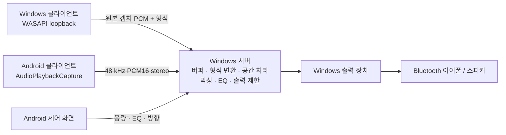

# Sound Manager

여러 Windows·Android 기기의 재생음을 Windows 서버에서 합쳐 Bluetooth 이어폰·스피커로 출력하는 초기 MVP입니다. Android 앱에서 전체 음량, EQ와 음원별 방향을 조정합니다.



## 구현 범위

- **Windows**: 서버/클라이언트 중 한 역할 선택. WASAPI 기본 출력 장치 캡처, 출력 장치 선택, 서버 연결 키, 음량 및 EQ 프리셋.
- **Android 10 이상**: 재생 오디오 전송, 전체 음량, 저음/고음/명료도 EQ, 음원별 음량·음소거와 0–359° 방향 제어. 포그라운드 서비스 및 알림에서 전송 중지.
- **서버 코어**: 최대 16개 음원, PCM16/float32 LE, 모노/스테레오, 8–192 kHz 입력. 서버에서 48 kHz float stereo로 변환하고 혼합. 입력별 제한된 버퍼, 언더런 재버퍼링, 소규모 클럭 드리프트 보정, 최종 출력 ±1 제한과 클리핑 계수.
- **EQ**: 120 Hz 저음 shelf, 4 kHz 고음 shelf, 2.5 kHz presence peaking, 각 ±12 dB. 기본/저음 강조/고음 강조/부드럽게/선명하게 프리셋.
- **가상 방향**: 좌우 레벨 차, 최대 약 0.63 ms 귀간 지연, 후방 고주파 감쇠. HRTF·머리 추적·실제 다채널 360° 렌더러는 아직 구현하지 않았습니다. 스피커와 청취 환경에 따라 전후 구별이 제한됩니다. 방향 사용 시 해당 스테레오 입력을 모노로 합쳐 배치하며, 꺼두면 좌우 채널을 유지합니다.

## 실행

1. Windows 서버 PC에 Bluetooth 이어폰/스피커를 페어링합니다.
2. `SoundManager.Windows.exe`를 실행하고 출력 장치를 선택한 뒤 **서버 시작**을 누릅니다.
3. Windows 방화벽 알림에서는 사용하는 **개인 네트워크** 접근을 허용합니다. 수동 설정이 필요한 경우 서버 TCP `17842`를 같은 LAN에 허용합니다.
4. Android 앱에 서버 화면의 `http://서버IP:17842`와 연결 키를 입력하고 연결합니다. VPN 등으로 주소가 여러 개 표시되면 휴대폰과 같은 네트워크의 주소를 선택합니다.
5. Android에서 **재생음 전송 시작**을 누르고 오디오 권한 및 시스템 캡처 승인을 합니다. 캡처 가능한 앱에서 음악을 재생합니다. 서버의 출력 장치로 합산된 음원이 재생됩니다.
6. 다른 Windows PC도 같은 앱의 **이 PC의 소리 전송**에 서버 주소/키를 입력하여 추가합니다. Android에서 전체 EQ와 각 음원의 가상 방향을 조정합니다.

서버를 다시 시작하면 연결 키가 바뀝니다. Android 앱은 서버 주소만 저장하며 연결 키는 저장하지 않습니다. 네트워크가 끊어지거나 서버가 다시 시작되면 주소/키를 확인하고 수동으로 재연결합니다.

## 개발 및 빌드

Windows 빌드에는 .NET 10 SDK, Android 빌드에는 JDK 17 또는 21, Android SDK 35 / Build Tools 35.0.0이 필요합니다. Android Studio에서 `android` 폴더를 열어도 됩니다. Gradle Wrapper 8.11.1과 Android Gradle Plugin 8.9.2를 고정했습니다.

```powershell
dotnet build SoundManager.sln -c Release
dotnet test tests/SoundManager.Tests -c Release
dotnet run --project src/SoundManager.Windows

# Android: ANDROID_HOME 설정 또는 android/local.properties에 sdk.dir 지정
cd android
.\gradlew.bat assembleDebug lintDebug
```

전체 빌드 및 배포 폴더 생성:

```powershell
.\scripts\build.ps1
# Windows만 빌드하려면 .\scripts\build.ps1 -SkipAndroid
```

- Windows: `artifacts/windows/SoundManager.Windows.exe` (x64, .NET 런타임 포함). 배포할 때 **폴더 전체**를 전달합니다.
- Android: `artifacts/android/SoundManager-debug.apk` (개발용 디버그 서명). 스토어용 릴리스 서명·배포는 포함하지 않습니다.
- CI: push/PR마다 Windows 빌드·테스트, Android APK 빌드·lint를 실행하고 GitHub Actions artifact로 저장합니다.

## 현재 제약

- Android는 재생 앱의 캡처 허용 정책을 따릅니다. DRM, 통화, 캡처 금지 앱의 소리는 전송되지 않을 수 있습니다. 마이크를 대신 녹음하지 않습니다. [Android 공식 문서](https://developer.android.com/media/platform/av-capture)
- 클라이언트는 캡처 이후 EQ/음량/리샘플링을 하지 않습니다. OS가 제공한 캡처 PCM을 전송하므로 **원본 음원 파일과 비트 단위 동일함을 보장하지는 않습니다**. Android 캡처 형식은 API에 48 kHz/16-bit/stereo를 요청합니다. Windows는 기본 출력 장치의 캡처 형식을 사용하며, 현재 16-bit PCM 또는 32-bit float의 모노/스테레오만 지원합니다.
- 초기 구성에서 서버는 Windows입니다. Android 서버와 Android Bluetooth 출력 호스트는 후속 범위입니다. 서버와 Windows loopback 클라이언트를 같은 PC에서 함께 실행하면 피드백이 발생할 수 있으므로 서로 다른 PC를 사용합니다. 클라이언트의 로컬 재생음은 자동으로 음소거하지 않습니다.
- 버퍼 시작 기준은 40 ms, 목표 약 60 ms, 최대 약 500 ms이며 Bluetooth/OS/네트워크 지연이 추가됩니다. 장치 간 절대 시간 동기화·동일 음원에 대한 샘플 단위 정렬은 아직 없습니다. 입력 레이트 변환은 선형 보간이며 스튜디오 품질 변환기는 아닙니다. 과부하 시 Windows 송신 큐와 서버 버퍼는 오래된 패킷/프레임을 버리며, Android는 200 ms 이상 송신 큐가 누적되면 전송을 중지합니다.
- 여러 음원이나 EQ 증폭으로 합산이 ±1을 넘으면 최종 출력이 잘립니다. 클리핑 수가 늘면 음원 또는 전체 음량을 낮추세요. 현재 제한기는 hard clip이며 look-ahead limiter는 후속 작업입니다.
- HTTP/WebSocket과 공유 연결 키를 사용하는 **신뢰하는 사설 LAN용 MVP**입니다. 전송 암호화, 사용자별 권한, 기기별 페어링·자동 검색은 아직 없습니다. 인터넷에 포트를 공개하지 않습니다.
- 실제 Android 기기·Bluetooth 이어폰/스피커에서의 지연·끊김·음질 검증은 별도 필요합니다. 아래 문서에 검증 상태와 절차를 기록합니다.

## 구조

| 경로 | 역할 |
| --- | --- |
| `src/SoundManager.Core` | 플랫폼 독립 PCM 버퍼, 리샘플링, 공간 처리, 믹서 및 EQ |
| `src/SoundManager.Server` | 인증된 REST 제어 및 WebSocket PCM 수신 |
| `src/SoundManager.Windows` | WPF 앱, WASAPI 출력/캡처 |
| `android/app` | Android 제어 화면 및 재생음 캡처 서비스 |
| `tests/SoundManager.Tests` | DSP 및 실제 HTTP/WebSocket 통합 테스트 |
| `docs/protocol.md` | 통신 규격 |
| `docs/validation.md` | 빌드/테스트 결과와 실기기 점검 절차 |

MIT 라이선스. 초기 버전 `0.1.0`.
